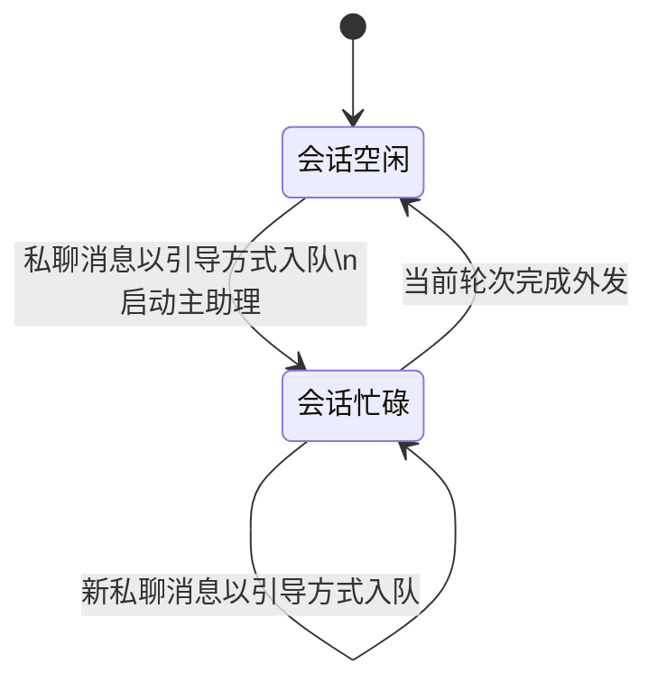
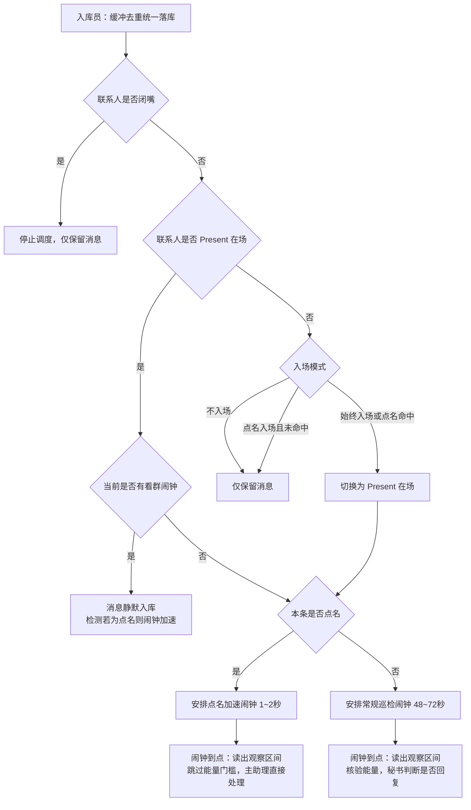
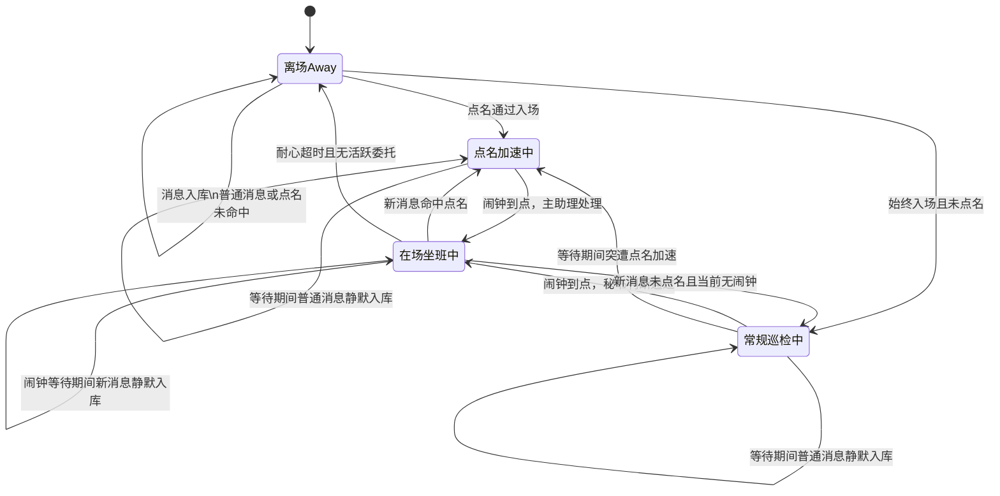

# 远程联系人状态机说明

本文使用业务语言说明当前远程联系人状态机。私聊和群聊采用不同处理模型，不能混为一套流程理解。

不同角色和委托实际获得的消息上下文，参见 [远程联系人上下文管理说明](remote_im_context_management.md)。

## 共同基础

无论私聊还是群聊，都遵守以下原则：

1. 远程消息先自然写入绑定会话。
2. 文字、图片、音频和附件都作为正式会话消息保存。
3. 联系人配置决定绑定人格、会话和耐心时间。
4. 私聊与群聊的区别发生在消息入库后的应答调度阶段。

群聊联系人使用以下参与状态：

- `离场`（`Away`）：助理没有主动参与当前联系人的对话。
- `在场`（`Present`）：助理正在参与或仍处于耐心等待期。

离场/在场只属于群聊。私聊不存在这两个状态，私聊只查看绑定会话当前是空闲还是忙碌。

消息处理严格划分为两个阶段：
1. **入库前（入站防抖缓冲）**：消息进入 1 秒内存缓冲，用于合并分段发送的碎片消息并按平台消息 ID 去重。1 秒安静后一次性统一批量写入数据库。落库完成的那一刻，防抖阶段彻底终结。
2. **入库后（看群巡检调度）**：消息已正式落库，系统纯粹由新消息生命周期驱动，按看群节奏巡检。系统内不存在无消息时的死循环空转。

---

# 一、私聊模型

私聊就是正常的会话，跟本地会话完全一样。

**唯一区别**：所有远程私聊消息落库后，直接以引导消息入队（`queue_mode = Guided`）。

私聊不使用群聊的任何机制：没有秘书、没有在场/离场、没有巡检、没有能量门槛、没有闭嘴控制。消息入库即引导入队，自然由会话主助理调度并外发回复。



---

# 二、群聊状态机

## 1. 群聊的核心模型

群聊不能把所有消息都直接交给助理，否则助理会介入与自己无关的话题。每条消息都先入库；`Away` 状态下只有通过入场判断的消息才会开始一次在场巡检。进入 `Present` 后，联系人已经在群里观察，后续消息属于持续巡检循环，不再重新要求命中点名词。

```text
Away + 消息入库
→ 始终入场：通过
→ 点名入场：命中点名词才通过
→ 不入场：不通过，仅保留消息

Present + 消息入库
→ 当前已有巡检批次：追加消息，保持原巡检等级
→ 当前没有巡检批次：创建下一次非点名巡检
→ 本条命中点名词：提升当前批次或下一批为点名巡检
```

未通过点名入场的消息只在 `Away` 状态下发生：它只保留在会话中，不创建秘书巡检、不调用模型。`Present` 是持续观察阶段，不是某个已完成批次的附属标签；批次收尾后，只要耐心时间尚未超时，下一条消息仍然进入下一次巡检。

助理防抖和秘书巡检不是同一种防抖，也不能使用同一条运行记录混合表示。

## 2. 消息生命周期与游标连续性

群聊 `Present` 期间，消息到达后先完成入站缓冲去重并统一落库；观察员按单调游标读取区间。

必须始终满足：

```text
旧游标（或入场起始点）
→ 本次观察区间内所有消息按原始顺序连续排列
→ 新游标（单调推进到最新）
```

规则：
- 游标是单向向前推进的尺子，读与推进在同一事务/锁内完成；
- 若旧游标消息因历史压缩已被物理清理，由观察员直接**重置游标**（重新定位到最新压缩摘要之后），绝不抓着已删除的旧 ID 报错；
- 严禁按群友筛选或截断正式上下文，严禁搞只看一条艾特的 `mention_only_read` 截肢操作。

## 3. 点名加速看群

点名加速用于“消息明确喊到助理（@助理、点名或命中唤醒词）”的情况。

处理规则：

1. 消息命中点名时，观察员将看群闹钟缩短为极短间隔（点名加速秒数，通常 1~2 秒），以便尽快出现并回答群友。
2. 点名加速到期后：
   - **跳过能量门槛，跳过回复冷却，不经过秘书判断**；
   - 观察员读出本次观察区间完整消息，直接交付给主助理；
   - 若已有正在运行中的活跃委托，跳过秘书，直接把新消息作为引导投递给该委托。

## 4. 常规巡检周期（非点名）

常规巡检用于 `Present` 期间的非点名观察，也用于刚从 `Away` 通过入场但未点名的首轮观察。它不属于 `Away` 状态未入场消息的入口：未入场的普通消息仅保存在库中。

处理规则：

1. `Present` 期间当前无闹钟的新消息到达时，创建一次以常规间隔为基础、带随机波动的看群闹钟（例如 60 秒基础间隔，波动范围 48~72 秒）。
2. **等待看群期间群友继续发言**：所有新消息静默入库，**闹钟绝不顺延、绝不重置**。若等待期间突遭点名，闹钟立刻升级为点名加速，提前看群。
3. 闹钟到期后，观察员读出本次观察区间的完整消息，结算区间内群成员的正负词能量收入并推进游标；
4. 随后由回应判断员裁决：
   - 检查当前能量是否满足 $E > 0$；不足则仅重置下次闹钟，游标不动；
   - 能量充足则调用秘书模型判断是否需要回复；
   - 秘书判断不回或发生网络故障（超时/502）：本轮结束；
   - 秘书决定回复：交由主助理创建新委托或引导已有委托。

## 5. 看群闹钟的单人单线程互斥

同一联系人同一时刻永远最多存在一个看群闹钟任务，绝不允许并发看群。

闹钟到点后，观察员执行看群；执行完毕后若群里再无新消息，系统自然恢复完全静止状态，不保留任何空转定时器。

## 6. 游标驱动的消息读取与结算

消息处理顺序固定为：

```text
入库员：消息缓冲去重，统一批量入库
→ 状态管理员：确认处于在场 Present
→ 观察员：闹钟到点，读取旧游标到最新之间的「本次观察区间」
→ 观察员：结算区间内正负词，推进游标，更新群能量
→ 裁决与应答：点名直达主助理，非点名经秘书把关后交由主助理
```

系统使用单调游标保证不重不漏，不使用版本令牌或 Generation 仲裁机制。

## 7. 读取范围口径

### 点名看群
读取从旧游标（或入场起始点）之后到最新一条消息的**完整观察区间**，随后创建或引导应答委托。严禁只读最后一条点名消息。

### 秘书判断
秘书需要的是：
- 观察起点之前最近的有限轻量历史；
- 旧游标到最新消息的完整观察区间。

秘书决定需要回答后，主助理使用完整的观察区间内容作为正式上下文。

## 8. 远程应答委托

群聊正式回复由独立的远程应答委托执行。

每个委托拥有：

- 唯一委托 ID；
- 触发消息锚点；
- 负责绑定人格；
- 冻结到触发锚点的正式上下文；
- 运行状态和结果。

同一联系人可以存在多个并发应答委托。秘书通过助理工作账本查看当前工作，并使用 `targetDelegateId` 把后续内容引导到正确委托。

## 9. 助理工作账本

助理工作账本由正式委托记录和委托会话统一生成，不从聊天文本临时猜测。

账本包含：

- 委托 ID；
- 工作状态：运行中、已完成、失败；
- 触发任务摘要；
- 实际回复摘要或失败原因；
- 开始和结束时间。

账本供以下链路共用：

- 秘书回复判断；
- 忙碌时的新建或引导选择；
- 新应答委托的系统提醒；
- 群聊离场反思。

## 10. 群聊离场

成功应答后，联系人保持在场并重新计算耐心时间。之后每次状态机确认继续保持 `Present`，都必须同时更新 `last_presence_at` 并刷新耐心计时器；只写 `presence_state = Present` 而不刷新计时器是不完整的状态转换。

`Present` 期间按秘书巡检周期持续观察群消息；一轮收尾后，新消息进入下一轮，而不是重新经过 `activation_mode`。耐心时间结束且没有活跃应答委托时：

1. 联系人转为离场；
2. 启动离场反思委托；
3. 反思读取当前会话上下文和助理工作账本；
4. 只应用反思结果中的记忆操作。

离场后：

- 未喊到助理的消息只入库，不触发看群；
- 喊到助理的消息重新通过入场判定并切为在场，安排点名加速看群。

## 11. 闭嘴状态

闭嘴和张嘴只属于群聊状态机，私聊不支持也不使用这套机制。

命中闭嘴词后：

- 联系人进入闭嘴期；
- 清除该联系人所有待执行看群闹钟；
- 中止该联系人所有仍在运行的远程应答委托；
- 闭嘴期间新消息只入库，不启动新的看群闹钟；
- 定时任务真正触发时再次检查闭嘴；
- 创建或引导应答委托前再次检查闭嘴；
- 自动发送与所有真正外发路径在转发前再次检查闭嘴。

因此：

- 闭嘴期间已经存在的旧定时任务也不能产生回复；
- 闭嘴前已在途的应答，能打断就立刻打断；
- 即便生成已经完成，真正转发到远程前也必须被拦截。

命中张嘴词或闭嘴时间到期后，联系人恢复正常消息观察。

## 12. 群聊总览图



## 13. 群聊状态图



---

# 三、私聊与群聊对照

| 维度 | 私聊 | 群聊 |
|---|---|---|
| 正式执行者 | 绑定会话主助理 | 独立远程应答委托 |
| 秘书 | 完全禁用 | 仅处理已入场的非点名消息，进行是否需要回复的语义把关 |
| 闭嘴/张嘴 | 不存在 | 支持群聊闭嘴期及多阶段调度拦截 |
| 调度方式 | 所有有效消息强制进入当前绑定会话 | 游标驱动看群 + 秘书把关 + 独立委托 |
| 点名处理 | 私聊不区分点名，消息天然直达助理 | 缩短看群闹钟（点名加速），跳过能量门槛直达主助理 |
| 未点名处理 | 仍然直接调度当前会话 | `Away` 时只有始终入场可启动看群；`Present` 期间普通消息按常规巡检周期看群，未入场消息只保存 |
| 忙碌中新消息 | 统一作为当前会话引导消息加入 | 主助理写回复期间新消息照常静默入库，两边完全解耦并行 |
| 正式上下文 | 绑定会话连续上下文 | 旧游标到最新消息的「本次观察区间」连续上下文 |
| 离场/在场 | 不存在 | 存在，耐心超时且无活跃委托后离场并反思 |

## 一句话总结

私聊就是正常的会话，跟本地会话完全一样，唯一区别就是所有远程消息直接以引导消息入队调度；群聊则先入站缓冲去重落库，`Away` 时由入场模式决定是否进入 `Present`，`Present` 期间由观察员按单调游标与看群节奏读出观察区间，点名直达主助理，非点名由秘书把关，逐轮先发正文再调工具并扣能，耐心超时且无活跃任务才回到 `Away`。
